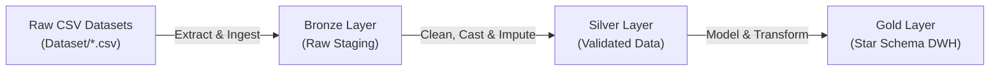

# 📚 Book Store Data Warehouse (Medallion Architecture)

[](https://www.python.org/)
[](https://www.microsoft.com/sql-server)
[](https://www.sqlalchemy.org/)
[](https://pandas.pydata.org/)

An end-to-end **Data Warehouse (DWH)** implementation for an online bookstore management system, following the industry-standard **Medallion Architecture** (Bronze ➔ Silver ➔ Gold).

---

## 🏗️ Architecture Overview

The pipeline organizes data into three analytical layers:



1. **Bronze Layer (`bronze` schema):**
   - Direct staging of raw source CSV files into SQL Server without transformations.
   - Text fields initialized with broad types (`varchar(50)` / `varchar(MAX)`) to guarantee raw ingestion.
2. **Silver Layer (`silver` schema):**
   - Cleaned, validated, and type-cast records (`int`, `float`, `datetime`).
   - Null-value imputation across author mappings, order items, and customer information.
3. **Gold Layer (`gold` schema):**
   - Dimensional modeling following a **Star Schema** with surrogate keys (`_sk`).
   - Dimension tables: `dim_customer`, `dim_book` (enriched with author information).
   - Fact table: `fact_orders` tracking sales, quantities, order dates, and book associations.

---

## 📁 Project Structure

```text
BookProject/
├── Dataset/                     # Source CSV records
│   ├── Author.csv               # Author biographical records
│   ├── Author_Book.csv          # Author-to-Book relationship mappings
│   ├── Book.csv                 # Book metadata (ISBN, category, price, pages)
│   ├── Book_Order.csv           # Line-item order details
│   ├── Category.csv             # Genre and category taxonomy
│   ├── Customer.csv             # Customer contact and address profiles
│   └── Ordering.csv             # Order headers and timestamps
├── SQL books_dwh;.sql           # DDL script defining schemas & tables (Bronze, Silver, Gold)
├── book.ipynb                   # ETL execution pipeline using Pandas & SQLAlchemy
└── README.md                    # Project documentation
```

---

## 🔄 ETL Pipeline Workflow

The ETL notebook (`book.ipynb`) manages the end-to-end data processing:

1. **Extraction:**
   - Reads 7 CSV files into Pandas DataFrames.
2. **Bronze Loading:**
   - Establishes an ODBC connection to SQL Server via SQLAlchemy (`create_engine`).
   - Appends raw records into `bronze.author`, `bronze.author_book`, `bronze.book`, `bronze.category`, `bronze.customer`, and `bronze.book_order`.
3. **Silver Transformation:**
   - Cleans string padding, handles null customer IDs, strips whitespace, and casts primary identifiers to integer types.
   - Loads normalized tables into `silver.*`.
4. **Gold Dimensional Modeling:**
   - Merges `book` metadata with `author_book` and `author` tables to produce denormalized book profiles (`dim_book`).
   - Formats customer names (`FirstName + LastName -> FullName`) to produce `dim_customer`.
   - Joins `ordering` and `book_order` with price and quantity calculations to load `fact_orders`.

---

## 🚀 Getting Started

### Prerequisites
- Python 3.8+
- Microsoft SQL Server instance (local or remote)
- Microsoft ODBC Driver 18 for SQL Server

### Setup
1. Execute `SQL books_dwh;.sql` in SQL Server Management Studio (SSMS) or Azure Data Studio to initialize the database and schemas:
   ```sql
   CREATE DATABASE books_dwh;
   ```
2. Install Python packages:
   ```bash
   pip install pandas sqlalchemy pyodbc
   ```
3. Open and run `book.ipynb` in Jupyter Notebook after updating your database connection string credentials.
