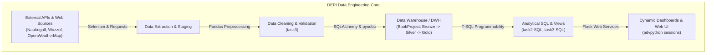

# 🚀 Digital Egypt Pioneers Initiative (DEPI) — Data Engineering Portfolio

[](https://www.python.org/)
[](https://www.microsoft.com/sql-server)
[](https://pandas.pydata.org/)
[](https://www.selenium.dev/)
[](https://flask.palletsprojects.com/)
[](https://jupyter.org/)

A comprehensive collection of practical projects, assignments, and pipelines developed during the **Digital Egypt Pioneers Initiative (DEPI)** track in **Data Engineering**.

This repository spans real-world data pipelines, modern data warehousing (Medallion architecture), automated web scrapers, advanced T-SQL programmability, and data-driven web applications.

---

## 🗺️ Project Directory & Overview

| Project / Task | Domain | Key Technologies | Description & Highlights |
| :--- | :--- | :--- | :--- |
| **[BookProject](./BookProject)** | Data Warehousing & ETL | SQL Server, SQLAlchemy, Pandas | Full **Medallion Architecture** (Bronze ➔ Silver ➔ Gold). Star schema modeling with `dim_customer`, `dim_book`, and `fact_orders`. |
| **[Task 1 - Flask & Selenium](./Task%201%20-%20Flask%20&%20Selenium)** | Web Scraping & Extraction | Selenium WebDriver, Chrome, Pandas | Automated discovery and extraction of Data Engineer job openings from **Naukrigulf**, exporting structured records to CSV. |
| **[task3](./task3)** | Data Cleaning & EDA | Python, Pandas, Jupyter | Complete data cleaning, type coercion, missing value imputation, duplicate removal, and business EDA on supermarket sales. |
| **[task2-SQL](./task2-SQL)** | Relational Querying | Microsoft SQL Server, T-SQL | 20 complex analytical queries on an educational schema: multi-table joins, encrypted views, CTEs, and window ranking (`DENSE_RANK`, `ROW_NUMBER`). |
| **[task3-SQL](./task3-SQL)** | Database Programmability | Microsoft SQL Server, T-SQL | 13 advanced database engineering solutions on banking schema: scalar & table-valued UDFs, stored procedures with validation, and balance-rollback triggers. |
| **[advpython sessions](./advpython%20sessions)** | Full-Stack Web Services | Flask, pyodbc, SQL Server, HTML/CSS | Database-backed Flask application querying SQL Server stored procedures and rendering dynamic customer reports via Pandas HTML tables. |
| **[advpython session3](./advpython%20session3)** | Automation Fundamentals | Selenium, Python | Browser automation exercises exploring element locators, search bars, and DOM navigation on W3Schools and Wikipedia. |
| **[physical session](./physical%20session)** | In-Person Labs & Workshops | Requests API, Selenium, Pandas | Real-time weather ETL pipeline across Egyptian governorates + multi-page job scraper for Egyptian tech roles on **Wuzzuf**. |

---

## 🏛️ Architecture & Core Highlights



---

## 🛠️ Technology Stack

- **Programming Languages:** Python 3.8+
- **Data Analysis & Processing:** Pandas, NumPy
- **Database Systems:** Microsoft SQL Server, T-SQL, ODBC Driver 18
- **ORM & Database Connectors:** SQLAlchemy, pyodbc
- **Web Automation & Scraping:** Selenium WebDriver, Chrome Options
- **Web Framework & UI:** Flask, Jinja2, HTML5, CSS3
- **Development Tools:** Jupyter Notebook, Azure Data Studio, SSMS, Visual Studio Code

---

## 🚀 Getting Started

### 1. Clone the Repository
```bash
git clone https://github.com/moaaz-z/DEPI.git
cd DEPI
```

### 2. Environment Setup
```bash
# Create and activate virtual environment
python -m venv venv

# Windows
.\venv\Scripts\activate

# Linux / macOS
source venv/bin/activate
```

### 3. Install Global Dependencies
```bash
pip install pandas numpy sqlalchemy pyodbc selenium flask requests jupyter
```

### 4. Explore Individual Modules
Each project folder contains its own dedicated documentation and usage instructions:
- [Book Store Data Warehouse Guide](./BookProject/README.md)
- [Naukrigulf Scraper Guide](./Task%201%20-%20Flask%20&%20Selenium/README.md)
- [Supermarket Sales Analysis Guide](./task3/README.md)
- [School Database SQL Guide](./task2-SQL/README.md)
- [Banking T-SQL Guide](./task3-SQL/README.md)
- [Flask & SQL Server Application Guide](./advpython%20sessions/README.md)
- [Physical Sessions Lab Guide](./physical%20session/README.md)

---

## 👥 Acknowledgments

Developed by **Moaaz Mohamed** as part of the **Digital Egypt Pioneers Initiative (DEPI)** Data Engineering track.
