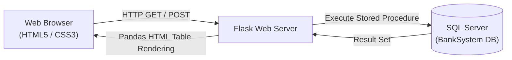

# ⚡ Flask & SQL Server Web Application

[](https://www.python.org/)
[](https://flask.palletsprojects.com/)
[](https://www.microsoft.com/sql-server)
[](https://github.com/mkleehammer/pyodbc)

A full-stack data-driven web application built with **Flask**, **Pandas**, and **Microsoft SQL Server (via pyodbc)** that demonstrates database-backed web services and dynamic reporting.

---

## 🎯 Architecture & Features



- **Database Connectivity:** Configured secure connection string to Microsoft SQL Server using ODBC Driver 18 with encrypted transport.
- **Stored Procedure Execution:** Dynamically executes parameterized stored procedures (e.g., `execute p1 {customer_id}`) to retrieve real-time bank customer records.
- **Dynamic Table Generation:** Converts Pandas DataFrames directly into rendered HTML tables (`df.to_html()`).
- **Jinja2 Templating & Styling:** Modular templates (`index.html`, `project.html`, `cst.html`) structured with custom CSS stylesheets (`static/style.css`).

---

## 📁 Repository Structure

```text
advpython sessions/
├── 1.ipynb                # Development notebook containing Flask routes and DB connectors
├── static/
│   └── style.css          # Frontend styling rules
├── templates/
│   ├── index.html         # Homepage and customer lookup form
│   ├── project.html       # Project overview page
│   └── cst.html           # Customer report template
└── README.md              # Documentation
```

---

## 🚀 How to Run

### Prerequisites
- Python 3.8+
- Microsoft SQL Server with the `BankSystem` database and `p1` stored procedure configured
- ODBC Driver 18 for SQL Server

### Installation
```bash
pip install flask pyodbc pandas
```

### Launching the Application
Run the Flask server from [`1.ipynb`](1.ipynb) or export to a `.py` script:
```bash
python -m flask --app 1 run
```
Navigate to `http://127.0.0.1:5000` to interact with the customer lookup interface.
